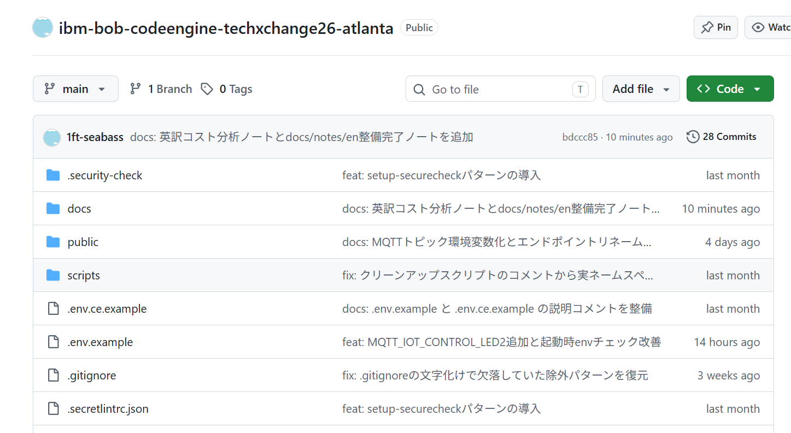
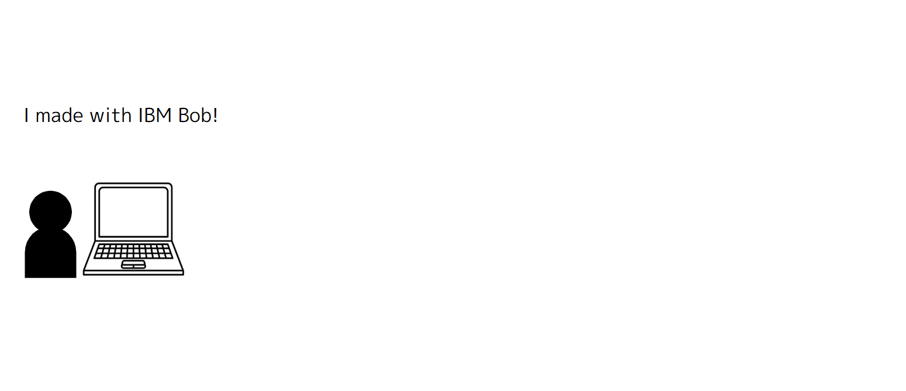
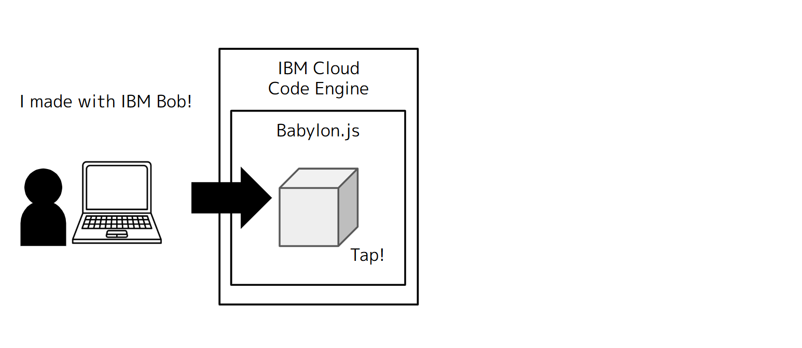
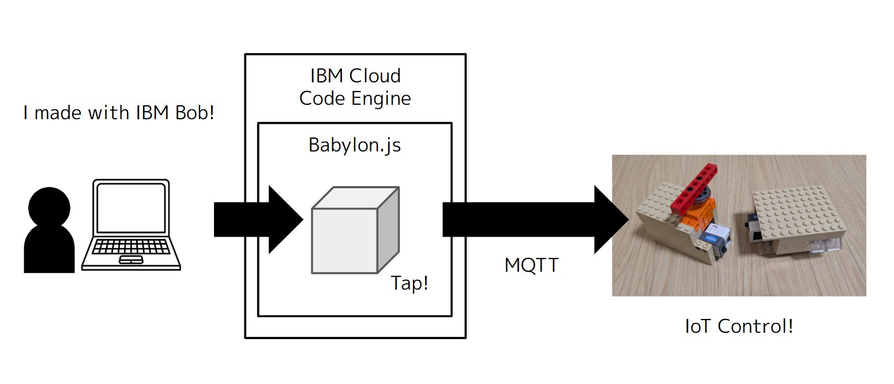

# Introduction & Today's Architecture

## Source code

Source code of today's architecture: https://github.com/1ft-seabass/ibm-bob-codeengine-techxchange26-atlanta

## Architecture

I made this with IBM Bob for my tech prototyping.

This is a Hono + Vue + Bootstrap + Babylon.js system running on IBM Cloud Code Engine.

When the Babylon.js cube is tapped, it controls an IoT light and an IoT servo with MQTT.

## How it works

- A Babylon.js cube UI makes an MQTT signal when tapped.
- IoT devices (a light and a servo) act when they receive the MQTT signal.

## Who does what

- Me
  - Sharing prototype-making knowledge and context with Bob.
- IBM Bob
  - Deploy flow (ibmcloud CLI)
  - Web backend + frontend
  - IoT MQTT protocol handling
  - Babylon.js 3D UI making

## Next

I want to build this kind of collaboration prototype for client work!