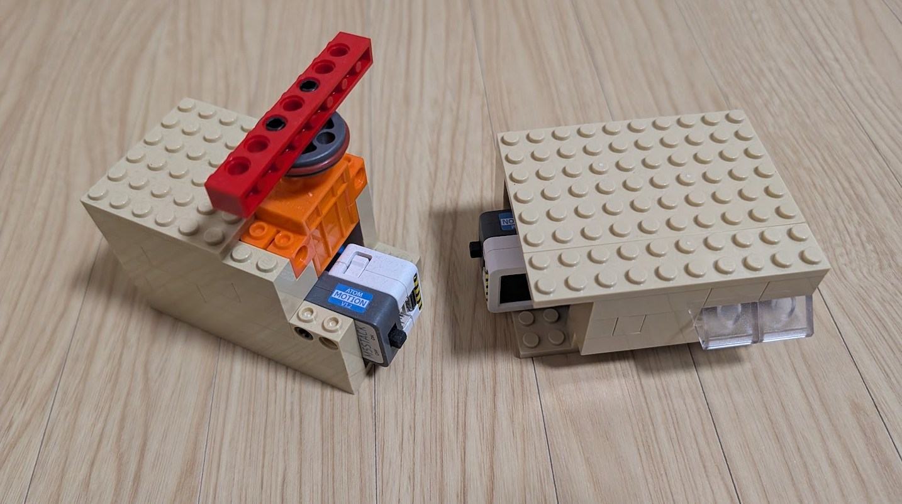

# Live Demo

Seeing is believing! I will show this live demo!

## Steps

- I open the web app on IBM Cloud Code Engine.
- It shows a rotating Babylon.js 3D cube.
- I tap it!
- The tap sends an MQTT message to the IoT devices (a light and a servo).

