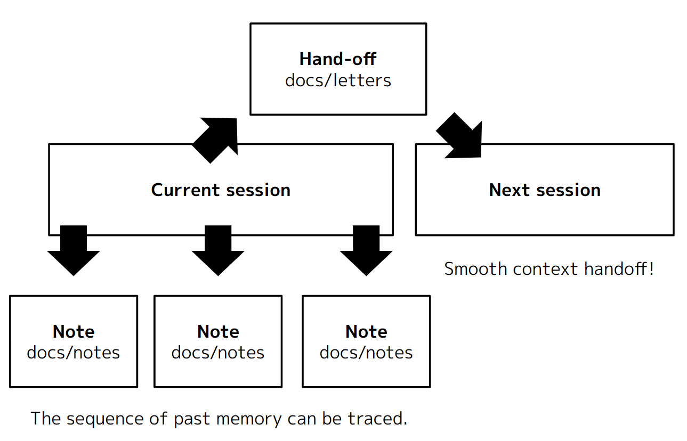

# Trial-and-error lessons

- Bob helped me with my IBM Cloud Code Engine setup and development.
  - Bob handled ibmcloud CLI tasks for me.
    - Creating the first Code Engine setup.
    - Deploying updated source code.
    - Checking instance health and cleaning up old build images.
- My notes and project history help Bob stay accurate.
  - notes/history = a knowledge management pattern for humans and AI.
  - It supports continuous development by keeping the history.
  - Actual source: https://github.com/1ft-seabass/my-ai-collaboration-patterns/tree/main/patterns/docs-structure-en
- Bob follows my prototyping process, starting with the 3D interface in Babylon.js.
  - I share my prototyping know-how with Bob.
    - For example, accurate spec docs.
  - With this knowledge, Bob helped me build prototypes even in new areas like 3D and IoT.

## How notes/history works

