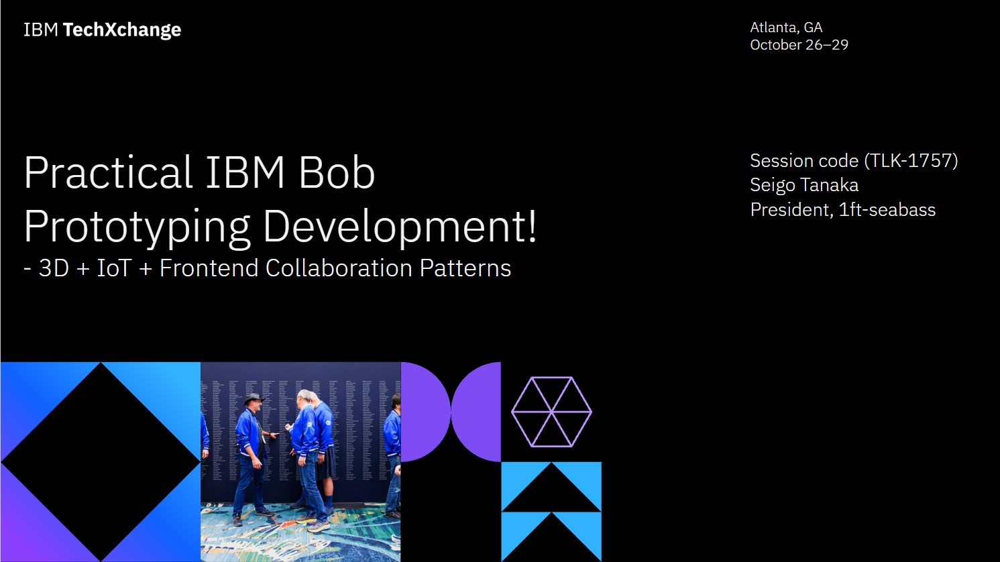

# README

This repository is Seigo Tanaka's "Practical IBM Bob Prototyping Development! - 3D + IoT + Frontend Collaboration Patterns" in IBM Techxchange Atlanta:)

- [Introduction](./01-introduction.md)
- [Live Demo](./02-live-demo.md)
- [Try and Error Points](./03-try-and-error-points.md)
- [Key Insights](./04-key-insights.md)